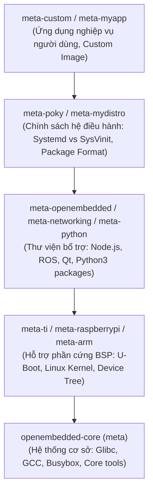

# 🏗️ Chương 11 (Yocto 1): Kiến Trúc Tổng Quan & Các Khái Niệm Cốt Lõi Của Yocto Project

> **Tài liệu tham khảo chính thức**:
> - [Yocto Project Overview and Concepts Manual](https://docs.yoctoproject.org/overview-manual/index.html)
> - [OpenEmbedded-Core Architecture](https://www.openembedded.org/wiki/OpenEmbedded-Core)

---

## 1. YOCTO PROJECT LÀ GÌ?

**Yocto Project KHÔNG PHẢI là một bản phân phối Linux** (như Ubuntu, Debian, Fedora hay Arch Linux).

Thay vào đó, **Yocto Project là một bộ công cụ, siêu dữ liệu (metadata) và quy trình chuẩn mở** được bảo trợ bởi Linux Foundation, cho phép các kỹ sư phần mềm nhúng:
- Tạo ra bản phân phối Linux tùy biến (**Custom Embedded Linux Distribution**) từ mã nguồn nguyên thủy (Vanilla Source Code).
- Kiểm soát toàn bộ hệ thống từ: Bootloader (U-Boot), Linux Kernel, Root Filesystem đến các ứng dụng không gian người dùng (User-space Applications).
- Tối ưu hóa kích thước hệ thống (từ vài MB đến vài chục MB, khởi động trong 1-2 giây) và tùy biến chặt chẽ theo phần cứng mục tiêu (ARM, RISC-V, MIPS, x86).

```
+-----------------------------------------------------------------------------------+
|                                  YOCTO PROJECT                                    |
|                                                                                   |
|  +-----------------------------------------------------------------------------+  |
|  |                                    POKY                                     |  |
|  |                                                                             |  |
|  |  +-------------------+   +-----------------------+   +-------------------+  |  |
|  |  |      BITBAKE      |   |  OPENEMBEDDED-CORE    |   |  META-YOCTO-BSP   |  |  |
|  |  |  (Task Scheduler  | + |       (OE-Core)       | + |  (Reference BSPs  |  |  |
|  |  |  & Python Engine) |   | (Core Recipes/Classes)|   |  QEMU, BeagleBone)|  |  |
|  |  +-------------------+   +-----------------------+   +-------------------+  |  |
|  +-----------------------------------------------------------------------------+  |
+-----------------------------------------------------------------------------------+
```

---

## 2. BỐN TRỤ CỘT CỦA HỆ SINH THÁI YOCTO

### 2.1. BitBake (Trình điều phối & thực thi tác vụ)
- Được viết bằng **Python**, BitBake đóng vai trò như một "nhạc trưởng".
- Đọc và phân tích cú pháp toàn bộ các file Metadata (`.bb`, `.conf`, `.bbclass`).
- Xây dựng cây phụ thuộc có hướng không chu trình (**DAG - Directed Acyclic Graph**) giữa các tác vụ (Tasks) của hàng trăm gói phần mềm.
- Điều phối thực thi đa luồng song song trên CPU đa nhân.

### 2.2. OpenEmbedded-Core (OE-Core)
- Tập hợp siêu dữ liệu (metadata) nền tảng chứa các công thức (recipes) chung nhất mà bất kỳ hệ điều hành Linux nào cũng cần:
  - C Thư viện chuẩn (`glibc`, `musl`).
  - Trình biên dịch chéo (`gcc`, `binutils`, `llvm`).
  - Hệ thống khởi tạo (`systemd`, `sysvinit`).
  - Các công cụ thiết yếu (`busybox`, `coreutils`, `bash`, `iproute2`).

### 2.3. Poky (Bản phân phối tham chiếu)
- Là dự án mã nguồn mở do Yocto Project duy trì, tích hợp sẵn:
  - BitBake
  - OE-Core
  - Meta-poky (Chính sách phân phối Linux tham chiếu)
  - Meta-yocto-bsp (Hỗ trợ các phần cứng tham chiếu: `qemuarm`, `qemux86-64`, `beaglebone-yocto`...).

### 2.4. Metadata (Siêu dữ liệu)
Là toàn bộ các file hướng dẫn cấu hình định nghĩa *cách thức* một phần mềm được xây dựng.

---

## 3. PHÂN LOẠI METADATA TRONG YOCTO

Yocto chia Metadata thành 4 định dạng file cốt lõi:

| Loại File | Phần mở rộng | Vai trò kỹ thuật | Ví dụ tiêu biểu |
| :--- | :--- | :--- | :--- |
| **Recipe** | `.bb` | "Công thức nấu ăn": Hướng dẫn tải nguồn ở đâu (`SRC_URI`), cách cấu hình (`do_configure`), biên dịch (`do_compile`) và đóng gói (`do_install`). | `nginx_1.24.0.bb`, `busybox_1.36.1.bb` |
| **Append** | `.bbappend` | Mở rộng hoặc ghi đè một Recipe có sẵn mà không cần sửa trực tiếp vào file `.bb` gốc (giữ nguyên tính toàn vẹn của layer gốc). | `linux-yocto_%.bbappend` |
| **Class** | `.bbclass` | Chứa logic tái sử dụng chung cho nhiều recipe (tương đương class trong OOP). | `cmake.bbclass`, `systemd.bbclass`, `kernel.bbclass` |
| **Configuration** | `.conf` | Định nghĩa các biến môi trường toàn cục, cấu hình phần cứng (Machine) hoặc chính sách bản phân phối (Distro). | `local.conf`, `bblayers.conf`, `machine/beaglebone-yocto.conf` |

---

## 4. KIẾN TRÚC LAYERS (`meta-*`)

Một trong những thế mạnh lớn nhất của Yocto là **Kiến trúc Layer (Phân tầng mô-đun hóa)**. Mọi thứ trong Yocto đều được tổ chức thành các thư mục bắt đầu bằng tiền tố `meta-`.



### Nguyên lý tách biệt Layer:
1. **Board Support Package (BSP) Layer**: Chỉ chứa những thứ thuộc về phần cứng cụ thể (Kernel config, Device Tree, Bootloader patches). Ví dụ: `meta-ti` cho Texas Instruments, `meta-raspberrypi` cho Raspberry Pi.
2. **Distribution Layer**: Chỉ chứa chính sách OS (Chọn Init system là `systemd` hay `SysVinit`, chọn thư viện C là `glibc` hay `musl`).
3. **Application Layer**: Chứa ứng dụng phần mềm của công ty/dự án của bạn.
4. **Lợi ích**: Khi nâng cấp phần cứng mới (ví dụ từ BeagleBone sang Raspberry Pi), bạn chỉ cần đổi BSP layer; toàn bộ Distro layer và Application layer được tái sử dụng 100%!

---

## 5. CÁC BIẾN CƠ BẢN BẮT BUỘC TRONG MỘT RECIPE (`.bb`)

Mỗi recipe (ví dụ `my-app_1.0.bb`) chứa các biến chuẩn:

```python
# Tên mô tả và tóm tắt gói
SUMMARY = "Ứng dụng điều khiển LED qua GPIO"
DESCRIPTION = "Chương trình C đọc nút bấm và điều khiển đèn LED"
HOMEPAGE = "https://github.com/myuser/my-app"

# Giấy phép bản quyền (Bắt buộc)
LICENSE = "MIT"
LIC_FILES_CHKSUM = "file://LICENSE;md5=d41d8cd98f00b204e9800998ecf8427e"

# Thông tin phiên bản
# PN = Package Name (tự động lấy từ tên file 'my-app')
# PV = Package Version (tự động lấy từ tên file '1.0')
# PR = Package Revision (mặc định 'r0')

# Nguồn tải mã nguồn (Git repo, HTTP URL, hoặc local files)
SRC_URI = "git://github.com/myuser/my-app.git;protocol=https;branch=main \
           file://my-app.service"
SRCREV = "a1b2c3d4e5f6..." # Git commit hash

# Thư mục giải nén nguồn
S = "${WORKDIR}/git"

# Kế thừa class hỗ trợ build (Ví dụ CMake, Autotools, hoặc tự viết)
inherit cmake systemd
```
