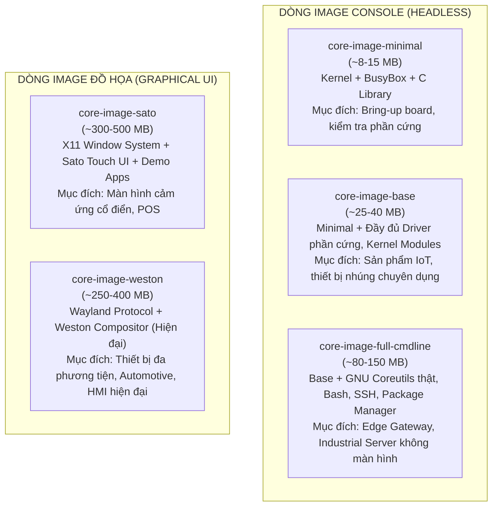

# 📦 Chương 13 (Yocto 3): Các Loại Image Tiêu Chuẩn Trong Yocto & Ý Nghĩa Thực Tế

> **Tài liệu tham khảo chính thức**:
> - [Yocto Project Reference Manual: Images](https://docs.yoctoproject.org/ref-manual/images.html)
> - [Poky Reference Images Source Code](https://git.yoctoproject.org/poky/tree/meta/recipes-core/images)

---

## 1. IMAGE TRONG YOCTO LÀ GÌ?

Trong Yocto Project, một **Image** là một **công thức cấp cao nhất (Top-level Recipe)** định nghĩa cấu trúc của hệ điều hành đích hoàn chỉnh sẽ được nạp vào phần cứng:
- Tập hợp danh sách các gói phần mềm (Packages) sẽ được giải nén vào Root Filesystem.
- Định dạng xuất xưởng nhị phân: `.ext4`, `.wic` (tạo phân vùng thẻ nhớ sẵn sàng boot), `.tar.bz2`, hoặc `.iso`.
- Các kịch bản cấu hình người dùng, phân quyền, cấu hình mạng ban đầu.

---

## 2. NĂM LOẠI IMAGE TIÊU CHUẨN CỦA POKY

Yocto Project cung cấp sẵn 5 loại image mẫu đại diện cho 5 mục đích sử dụng khác nhau:



---

### 2.1. `core-image-minimal` (Tối giản - Nhỏ gọn nhất)
- **Cấu hình bên trong**:
  - Chỉ bao gồm: Linux Kernel, thư viện C (`glibc` hoặc `musl`), và **BusyBox** (cung cấp các lệnh shell tối giản `ls`, `sh`, `cp`, `cat` gộp chung vào 1 file nhị phân).
  - Không có trình biên dịch, không có công cụ phát triển, không có giao diện mạng nâng cao.
- **Dung lượng RootFS**: Rất nhỏ, chỉ từ **8 MB đến 15 MB**.
- **Thời gian build**: Nhanh nhất (khoảng 20-30 phút trong lần build đầu tiên).
- **Ứng dụng thực tế**:
  - **Board Bring-up**: Dùng khi bạn vừa thiết kế xong một bo mạch phần cứng mới, muốn kiểm tra xem CPU có chạy không, U-Boot có nạp được Kernel không, UART có in log không.
  - Phù hợp với các thiết bị có bộ nhớ Flash SPI rất nhỏ (16MB - 32MB).

---

### 2.2. `core-image-base` (Nền tảng nhúng chuyên dụng)
- **Cấu hình bên trong**:
  - Giống như `core-image-minimal` nhưng bổ sung **toàn bộ các kernel modules và firmware** để hỗ trợ đầy đủ các ngoại vi của bo mạch (WiFi, Bluetooth, Ethernet PHY, USB, I2C, SPI sensors).
  - Vẫn chạy ở chế độ Console (Headless), không có giao diện đồ họa.
- **Dung lượng RootFS**: Khoảng **25 MB đến 40 MB**.
- **Ứng dụng thực tế**:
  - Là **điểm khởi đầu lý tưởng nhất (Best baseline)** để bạn xây dựng hệ điều hành thương mại cho các sản phẩm IoT công nghiệp, bộ điều khiển PLC, thiết bị đo lường từ xa.

---

### 2.3. `core-image-full-cmdline` (Hệ thống dòng lệnh hoàn chỉnh)
- **Cấu hình bên trong**:
  - Thay thế BusyBox bằng **GNU Coreutils thật**: `bash` (thay vì `ash`), `grep`, `gawk`, `find`, `sed` đầy đủ tính năng.
  - Hỗ trợ đa người dùng nâng cao, trình quản lý gói (`opkg`/`apt`), hệ thống mạng đầy đủ (`iproute2`, `iptables`, `openssh`).
- **Dung lượng RootFS**: Khoảng **80 MB đến 150 MB**.
- **Ứng dụng thực tế**:
  - Các thiết bị Edge Computing, Router/Gateway công nghiệp, hệ thống Server nhúng cần môi trường lập trình script Bash phức tạp.

---

### 2.4. `core-image-sato` (Giao diện đồ họa X11 Sato)
- **Cấu hình bên trong**:
  - Hệ thống cửa sổ đồ họa **X11 (X.Org)** kết hợp môi trường màn hình cảm ứng **Sato UI** (viết bằng GTK+).
  - Đi kèm các ứng dụng mẫu: Trình quản lý file, Terminal đồ họa, Trình phát nhạc/video, Bàn phím ảo trên màn hình cảm ứng.
- **Dung lượng RootFS**: **300 MB đến 500 MB**.
- **Ứng dụng thực tế**:
  - Máy bán hàng POS, bảng điều khiển cảm ứng công nghiệp, thiết bị y tế cầm tay có màn hình nhỏ.

---

### 2.5. `core-image-weston` (Giao diện đồ họa hiện đại Wayland)
- **Cấu hình bên trong**:
  - Sử dụng giao thức đồ họa hiện đại **Wayland** và trình tổng hợp tham chiếu **Weston**, loại bỏ hoàn toàn kiến trúc nặng nề cũ kỹ của X11.
  - Tận dụng khả năng tăng tốc phần cứng 2D/3D GPU (OpenGL ES / DRM / KMS).
- **Dung lượng RootFS**: **250 MB đến 400 MB**.
- **Ứng dụng thực tế**:
  - Màn hình thông tin giải trí ô tô (Automotive In-Vehicle Infotainment), bảng điều khiển nhà thông minh (Smart Home Hub), giao diện HMI cảm ứng thế hệ mới.

---

## 3. BẢNG SO SÁNH TỔNG QUAN GIỮA CÁC IMAGE

| Tên Image | Giao diện | Dung lượng RootFS | RAM tối thiểu | Thời gian Build lần đầu | Mục đích sử dụng tiêu biểu |
| :--- | :---: | :---: | :---: | :---: | :--- |
| **`core-image-minimal`** | Console | **~10 MB** | 64 MB | ~25 phút | Bring-up board, kiểm tra bootloader/kernel. |
| **`core-image-base`** | Console | **~30 MB** | 128 MB | ~35 phút | Sản phẩm IoT công nghiệp, thiết bị đo lường. |
| **`core-image-full-cmdline`** | Console | **~120 MB** | 256 MB | ~50 phút | Edge Gateway, Server nhúng không màn hình. |
| **`core-image-sato`** | X11 (Sato) | **~400 MB** | 512 MB | ~90 phút | Máy tính bảng nhúng, giao diện X11 cảm ứng. |
| **`core-image-weston`** | Wayland | **~350 MB** | 512 MB | ~80 phút | HMI hiện đại, thiết bị màn hình đồ họa GPU. |

---

## 4. TỰ TẠO MỘT CUSTOM IMAGE CHO DỰ ÁN

Thay vì dùng `IMAGE_INSTALL:append` trong `local.conf` (chỉ có tác dụng trên máy cá nhân của bạn), cách chuyên nghiệp nhất trong dự án là tạo một file Recipe cho riêng image của công ty bạn:

Ví dụ tạo file: `recipes-core/images/my-iot-image.bb`:

```python
# Kế thừa toàn bộ cấu hình nền tảng của core-image-base
require recipes-core/images/core-image-base.bb

SUMMARY = "Custom IoT Gateway Image for Company Project"
DESCRIPTION = "Hệ điều hành nhúng tùy biến tích hợp WiFi, SSH, Python3 và App quản lý"

# Bổ sung các tính năng cấp hệ thống
IMAGE_FEATURES += "ssh-server-openssh package-management"

# Khai báo danh sách các gói phần mềm cần cài đặt vào RootFS
IMAGE_INSTALL += " \
    packagegroup-core-boot \
    packagegroup-base-wifi \
    kernel-modules \
    python3 \
    python3-pip \
    htop \
    curl \
    my-custom-firmware \
    my-telemetry-app \
"

# Đặt dung lượng trống bổ sung cho RootFS (ví dụ chừa thêm 50MB để người dùng lưu dữ liệu)
IMAGE_ROOTFS_EXTRA_SPACE = "51200"
```

Khi build, bạn chỉ cần gõ:
```bash
bitbake my-iot-image
```
BitBake sẽ tạo ra đúng bản phân phối tùy biến của bạn mà không ảnh hưởng tới bất kỳ cấu hình nào khác!

---

## 5. GIẢI MÃ PHÂN VÙNG Ổ ĐĨA: `IMAGE_ROOTFS_EXTRA_SPACE` VÀ DUNG LƯỢNG THẺ NHỚ CÒN LẠI

### 5.1. `IMAGE_ROOTFS_EXTRA_SPACE` thuộc về đâu?
**Chính xác 100%!** Biến này thuộc về **phân vùng Root Filesystem (`/`)**.
- Ví dụ: Toàn bộ phần mềm cài đặt chiếm 40 MB.
- Bạn cấu hình: `IMAGE_ROOTFS_EXTRA_SPACE = "102400"` (100 MB).
- Kết quả: Phân vùng `/` khi xuất xưởng sẽ có kích thước $40 + 100 = 140$ MB. Khi boot hệ điều hành lên và gõ `df -h /`, bạn sẽ thấy phân vùng `/` có dung lượng 140 MB, trong đó còn trống sẵn đúng 100 MB.

---

### 5.2. Vậy phần dung lượng còn lại của thẻ nhớ (ví dụ thẻ 16GB, 32GB) sẽ nằm ở đâu?
Khi Yocto tạo ra file image đĩa `.wic` (hoặc `.img`), nó chỉ tạo ra một file có kích thước vừa khít bằng tổng các phân vùng đã khai báo:
- Phân vùng 1 (BOOT): 64 MB
- Phân vùng 2 (ROOTFS `/`): 140 MB
- $\rightarrow$ File `.wic` xuất xưởng chỉ nặng khoảng **204 MB**!

Khi bạn dùng `dd` hoặc `bmaptool` ghi file 204 MB này vào thẻ nhớ 16 GB:
- Thẻ nhớ sẽ có 204 MB đầu tiên là 2 phân vùng hợp lệ.
- **Toàn bộ phần dung lượng còn lại (khoảng 15.8 GB) trở thành Unallocated Space (Vùng nhớ chưa phân vùng / Trống hoàn toàn)**!
- Lúc này, Linux **chưa nhìn thấy và chưa thể ghi dữ liệu** vào 15.8 GB đó.

```
CẤU TRÚC THẺ NHỚ SAU KHI FLASH FILE .WIC (VÍ DỤ THẺ 16GB):
+---------------+-------------------+---------------------------------------------+
| Partition 1   | Partition 2       |               UNALLOCATED SPACE             |
| BOOT (FAT32)  | ROOTFS (ext4, /)  |            (VÙNG CHƯA PHÂN VÙNG)            |
|    64 MB      |     140 MB        |                   ~15.8 GB                  |
+---------------+-------------------+---------------------------------------------+
                 ▲
                 └── Chứa IMAGE_ROOTFS_EXTRA_SPACE (100MB trống tại đây)
```

---

### 5.3. Làm sao để sử dụng hết 15.8 GB còn trống đó?
Trong ngành lập trình Linux nhúng, có **2 giải pháp kinh điển**:

#### Phương án 1: Tự động phình to phân vùng `/` khi khởi động lần đầu (Auto-resize RootFS)
Khi bo mạch khởi động lần đầu tiên, một script chạy ngầm sẽ tự động mở rộng phân vùng 2 lên chiếm 100% dung lượng thẻ nhớ:
1. Dùng công cụ `parted` hoặc `growpart` để kéo dài ranh giới partition 2 ra hết thẻ.
2. Chạy lệnh: `resize2fs /dev/mmcblk0p2` để mở rộng hệ thống tệp ext4 online.
3. Trong Yocto, bạn chỉ cần thêm gói:
   - Với systemd: Thêm `systemd-growfs` vào image.
   - Hoặc thêm package `resize-rootfs` (rất phổ biến trong `meta-oe` / `meta-raspberrypi`). Khi đó phân vùng `/` sẽ tự động nhảy lên thành 16 GB!

#### Phương án 2 (Khuyên dùng cho sản phẩm công nghiệp): Tạo phân vùng thứ 3 riêng biệt cho Data (`/data`)
Thay vì để phân vùng hệ điều hành phình to (rất dễ hỏng hệ điều hành nếu rút điện đột ngột), các kỹ sư tạo ra **3 phân vùng độc lập**:
- **Partition 1 (`/boot`)**: FAT32 chứa MLO, U-Boot, Kernel.
- **Partition 2 (`/`)**: ext4 chứa RootFS (có thể đặt Read-Only để chống virus và chống hỏng khi mất điện).
- **Partition 3 (`/data` hoặc `/home`)**: ext4 chiếm trọn vẹn toàn bộ dung lượng còn lại của thẻ nhớ để lưu Database, Log và file của người dùng.

Trong Yocto, điều này được cấu hình cực kỳ dễ dàng qua file **Wic Kickstart (`.wks`)**:
```
part /boot --source bootimg-partition --ondisk mmcblk0 --fstype=vfat --label boot --active --align 4 --size 64
part /     --source rootfs            --ondisk mmcblk0 --fstype=ext4 --label root --align 4
part /data --ondisk mmcblk0           --fstype=ext4 --label data --size 1024 --grow
```
*(Tham số `--grow` tự động ra lệnh: Phân vùng `/data` sẽ phình to ra hết sạch dung lượng còn lại của thẻ nhớ).*

---

## 6. BẢN CHẤT "LỆNH" TRONG BITBAKE & CÁCH TẠO TÊN IMAGE TÙY Ý

### 6.1. Tại sao mặc định chỉ có các lệnh image có sẵn?
Khi bạn gõ `bitbake <target>`, bạn cần hiểu rằng:
> **`<target>` KHÔNG PHẢI LÀ MỘT LỆNH ĐƯỢC LẬP TRÌNH SẴN TRONG BITBAKE!**
> `<target>` thực chất là **TÊN FILE RECIPE (bỏ đuôi `.bb`)** mà BitBake tìm thấy trong các Layer được khai báo trong `bblayers.conf`!

Mặc định Poky chỉ có sẵn các file:
- `meta/recipes-core/images/core-image-minimal.bb` $\rightarrow$ Bạn gõ được: `bitbake core-image-minimal`
- `meta/recipes-core/images/core-image-base.bb` $\rightarrow$ Bạn gõ được: `bitbake core-image-base`
- `meta/recipes-core/images/core-image-sato.bb` $\rightarrow$ Bạn gõ được: `bitbake core-image-sato`

---

### 6.2. Các bước để tự tạo một "lệnh" Custom Image hoàn toàn mới
Để tạo ra một lệnh build mới (ví dụ: `bitbake thinh-smart-gateway`), bạn thực hiện đúng 3 bước:

#### Bước 1: Đặt tên file `.bb` theo đúng tên bạn muốn gõ lệnh
Trong layer của bạn (`meta-myproject`), tạo thư mục:
`meta-myproject/recipes-core/images/`

Tạo file có tên: `<tên_lệnh_bạn_muốn>.bb`.
Ví dụ bạn tạo file:
```
meta-myproject/recipes-core/images/thinh-smart-gateway.bb
```

#### Bước 2: Viết nội dung kế thừa cho file Recipe
Mở file `thinh-smart-gateway.bb` và viết:
```python
SUMMARY = "He dieu hanh Smart Gateway cua Thinh"
LICENSE = "MIT"

# Kế thừa lõi xây dựng image của Yocto (Bắt buộc phải có 1 trong 2 dòng này)
inherit core-image
# Hoặc kế thừa từ minimal: require recipes-core/images/core-image-minimal.bb

# Thêm bất kỳ phần mềm nào bạn muốn cài sẵn vào hệ điều hành:
IMAGE_INSTALL += " \
    my-app \
    python3 \
    htop \
    curl \
"

# Bật tính năng
IMAGE_FEATURES += "debug-tweaks ssh-server-dropbear"
```

#### Bước 3: Đảm bảo Layer đã nằm trong `bblayers.conf`
Chạy lệnh kiểm tra xem BitBake đã nhận diện được image mới của bạn chưa:
```bash
bitbake-layers show-recipes "*-image*"
```
Trong danh sách hiện ra, bạn sẽ thấy xuất hiện:
```
thinh-smart-gateway:
  meta-myproject       1.0
```

Bây giờ bạn có thể gõ "lệnh" build mới của bạn ở bất kỳ đâu trong thư mục build:
```bash
bitbake thinh-smart-gateway
```
BitBake sẽ tự động nhận diện, tải nguồn, build kernel, biên dịch các gói bạn chọn và đóng gói thành bản Linux mang tên của bạn!

