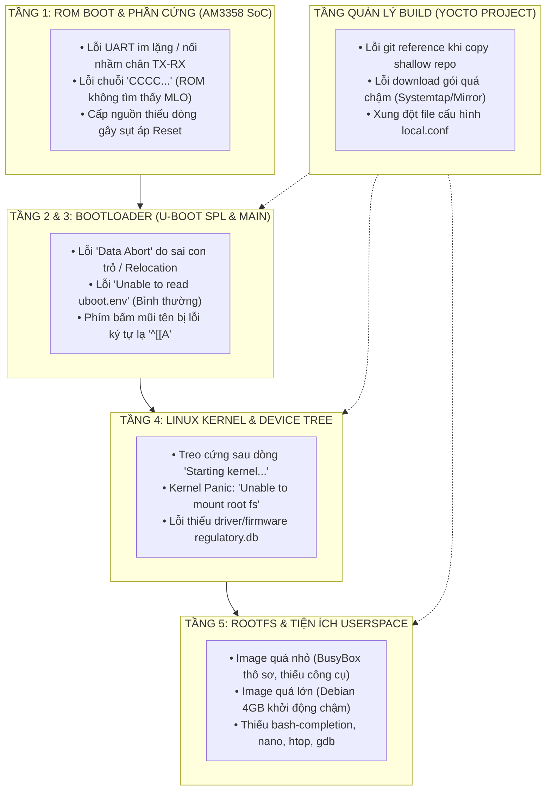

# Chương 30: Tổng Hợp Lỗi, Các Điểm Lưu Ý Sống Còn & Cẩm Nang Sử Dụng Bản Build Debug BeagleBone Black

Tài liệu này tổng hợp toàn bộ kinh nghiệm thực chiến từ quá trình thiết lập môi trường, phân tách workspace Yocto, giải quyết các sự cố lỗi ở cả 5 tầng kiến trúc phần cứng - phần mềm, các lưu ý sống còn về phần cứng vi xử lý **Texas Instruments Sitara AM3358**, và cẩm nang chi tiết hướng dẫn sử dụng bản build developer **`bbb-debug-image`** qua giao tiếp **Serial UART**.

---

## 🗺️ Bản Đồ 5 Tầng Kiến Trúc & Vị Trí Phát Sinh Lỗi



---

## PHẦN I: TỔNG HỢP CÁC LỖI THỰC TẾ & PHƯƠNG PHÁP KHẮC PHỤC THEO PHÂN TẦNG

### 1. Sự cố ở Tầng 1: ROM Code & Phần Cứng (AM3358 SoC)

#### 🔴 Lỗi 1.1: Cắm nguồn nhưng màn hình Serial Console im lặng hoàn toàn
- **Hiện tượng**: Đã bật phần mềm `screen` hoặc `picocom` trên máy tính nhưng không có bất kỳ ký tự nào xuất hiện khi cấp nguồn cho BeagleBone Black.
- **Nguyên nhân cốt lõi**:
  1. Đấu sai chân nối tiếp: Header J1 trên BeagleBone Black có thứ tự chân rất đặc thù (Pin 1 có chấm trắng là **GND**, Pin 4 là **RX**, Pin 5 là **TX**). Nếu cắm TX nối TX hoặc RX nối RX thì mạch sẽ không truyền nhận được tín hiệu.
  2. Mạch USB-to-UART chưa tiếp xúc mass (GND) chung giữa PC và BeagleBone.
  3. Cấp nguồn không đủ dòng: Cổng USB máy tính chỉ cấp được 500mA, khi board khởi động tải đỉnh có thể sụt áp khiến chip PMIC TPS65217C ngắt nguồn.
- **Cách khắc phục chuẩn**:
  - Đấu nối chính xác theo sơ đồ:
    - **Pin 1 (GND - chấm trắng)** $\leftrightarrow$ **GND** module USB-UART.
    - **Pin 4 (RXD)** $\leftrightarrow$ **TXD** module USB-UART.
    - **Pin 5 (TXD)** $\leftrightarrow$ **RXD** module USB-UART.
  - Thiết lập thông số Serial trên PC đúng chuẩn: **Baudrate 115200, 8 Data bits, No parity, 1 Stop bit (115200 8N1)**.
  - Sử dụng nguồn cắm Jack tròn DC 5V/2A ngoài để đảm bảo nguồn điện ổn định.

---

#### 🔴 Lỗi 1.2: Terminal in liên tục một chuỗi ký tự `CCCC...`
- **Hiện tượng**: Khi bật nguồn, terminal UART xuất hiện liên tục các chữ cái:
  ```text
  CCCCCCCCCC...
  ```
- **Bản chất kỹ thuật (Theo TI SPRUH73 TRM - Chapter 26)**:
  - Khi ROM Code không tìm thấy bootloader hợp lệ (`MLO`) trên thiết bị lưu trữ ưu tiên (eMMC hoặc MicroSD), nó sẽ chuyển xuống mức ưu tiên tiếp theo là **UART Boot Mode**. Ký tự `C` là mã yêu cầu truyền file qua giao thức **XMODEM** gửi từ ROM Code của chip AM3358.
- **Cách khắc phục**:
  - **Quên giữ nút S2 (BOOT Button)**: Mặc định ROM code sẽ tìm đọc chip eMMC trên mạch trước. Nếu eMMC trống hoặc hỏng, bạn bắt buộc phải **nhấn và giữ nút S2** (nút bấm nhỏ gần khe cắm thẻ MicroSD) rồi mới cắm nguồn. Giữ nút từ 3 đến 5 giây để ép ROM code chuyển sang đọc thẻ MicroSD (`MMC0`).
  - **Thẻ nhớ chưa có cờ Bootable hoặc sai định dạng**: Phân vùng số 1 của thẻ nhớ phải được định dạng **FAT32 (LBA)** và được đánh dấu cờ `bootable`. File `MLO` phải nằm ở phân vùng này.

---

#### 🔴 Lỗi 1.3: Lỗi khi clone workspace Yocto: `reference repository is shallow`
- **Hiện tượng**: Khi dùng lệnh `git clone --reference /home/thinh/yocto-lab/poky ...` để tách workspace mới độc lập với Raspberry Pi 5, Git báo lỗi:
  ```text
  fatal: reference repository '/home/thinh/yocto-lab/poky' is shallow
  ```
- **Bản chất**: Kho mã nguồn gốc được clone ở chế độ `--depth 1` (shallow clone) nên Git không cho phép dùng làm kho tham chiếu.
- **Cách khắc phục**: Dùng `rsync` có chọn lọc để sao chép toàn bộ source code mà **không chạm vào thư mục `build/` của dự án cũ**:
  ```bash
  rsync -av --exclude 'build' /home/thinh/yocto-lab/poky/ /home/thinh/yocto-bbb/poky/
  ```

---

### 2. Sự cố ở Tầng 2 & 3: Bootloader U-Boot

#### 🔴 Lỗi 2.1: U-Boot bị Crash: `data abort` / `prefetch abort`
- **Hiện tượng**: Sau khi in vài dòng log của U-Boot, màn hình hiện thông báo đổ vỡ thanh ghi:
  ```text
  data abort
  pc : [<9ff7a124>]          lr : [<9ff7a0e8>]
  reloc pc : [<80801124>]    lr : [<808010e8>]
  Resetting CPU ...
  ```
- **Bản chất**: CPU thực hiện một lệnh truy cập con trỏ NULL hoặc truy cập vùng nhớ ngoài dải vật lý hợp lệ.
- **Quy trình gỡ lỗi chuyên sâu**:
  1. U-Boot sau khi khởi tạo DDR3 sẽ tự sao chép (relocate) lên vùng đỉnh của RAM. Vì vậy giá trị `pc` hiển thị là địa chỉ trên RAM hiện hành.
  2. Tra cứu giá trị `reloc pc` (Original PC lúc biên dịch):
     $$\text{Original PC} = \text{Current PC} - (gd\to reloc\_off)$$
  3. Dùng công cụ `addr2line` trỏ vào file ELF `u-boot` unstripped để tìm ra vị trí code C bị lỗi:
     ```bash
     addr2line -e /home/thinh/yocto-bbb/build/tmp/work/beaglebone_yocto-poky-linux-gnueabi/u-boot/2024.01/build/u-boot 0x80801124
     ```

---

#### 🔴 Lỗi 2.2: Lỗi `Unable to read "uboot.env" from mmc0:1...`
- **Hiện tượng**: Trong quá trình boot, U-Boot in dòng cảnh báo:
  ```text
  Loading Environment from FAT... Unable to read "uboot.env" from mmc0:1...
  ```
- **Bản chất & Đánh giá**: Đây là thông báo **HOÀN TOÀN BÌNH THƯỜNG**, không phải lỗi. U-Boot kiểm tra xem người dùng có lưu file biến môi trường tùy biến `uboot.env` trên phân vùng FAT32 hay không. Nếu chưa có, U-Boot sẽ tự động dùng cấu hình mặc định biên dịch sẵn bên trong mã nguồn (`default environment`).

---

#### 🔴 Lỗi 2.3: Bấm phím mũi tên hoặc phím điều hướng bị in ra ký tự lạ `^[[A`, `^[[B`
- **Hiện tượng**: Khi đang nhập lệnh trên Serial Console, bấm mũi tên Lên thì không ra lệnh cũ mà xuất hiện chuỗi ký tự `^[[A`.
- **Nguyên nhân**:
  1. Hệ điều hành đang sử dụng shell rút gọn của BusyBox (`ash`), không hỗ trợ thư viện Readline đầy đủ.
  2. Biến môi trường hiển thị terminal chưa được khai báo `TERM=xterm-256color`.
- **Cách khắc phục**:
  - Tích hợp vỏ lệnh **GNU Bash** (`bash`) và gói **`bash-completion`** vào image Yocto.
  - Cấu hình file `/home/root/.bashrc` tự động gán `export TERM=xterm-256color`.

---

### 3. Sự cố ở Tầng 4: Linux Kernel & Device Tree

#### 🔴 Lỗi 3.1: Kernel treo cứng ngay sau dòng chữ `Starting kernel ...`
- **Hiện tượng**: U-Boot in ra:
  ```text
  Starting kernel ...
  ```
  Sau đó màn hình dừng hẳn, không có bất kỳ log Linux nào xuất hiện tiếp theo.
- **Nguyên nhân cốt lõi**:
  1. **Thiếu tham số Console**: Kernel đã boot nhưng không biết xuất log ra đâu do `bootargs` bị mất chuỗi `console=ttyS0,115200n8`.
  2. **Device Tree không tương thích**: File `.dtb` nạp vào RAM không khớp với phần cứng của bo mạch (ví dụ nạp nhầm `am335x-bone.dtb` của bản White cho bản Black).
- **Cách gỡ lỗi chuẩn xác**:
  - Dùng cờ **`earlycon`** (Early Console) để ép Kernel xuất log ngay từ instruction đầu tiên của `start_kernel()` qua driver thanh ghi trực tiếp:
    ```text
    => setenv bootargs console=ttyS0,115200n8 earlycon=uart8250,mmio32,0x44e09000,115200n8 root=/dev/mmcblk0p2 rw
    => boot
    ```

---

#### 🔴 Lỗi 3.2: Kernel Panic: `VFS: Unable to mount root fs on unknown-block(0,0)`
- **Hiện tượng**: Kernel in log bình thường đến bước cuối thì sụp đổ (*Panic*) kèm thông báo:
  ```text
  Kernel panic - not syncing: VFS: Unable to mount root fs on unknown-block(0,0)
  ```
- **Bản chất**: Kernel không tìm thấy hoặc không đọc được phân vùng Root Filesystem.
- **Cách khắc phục**:
  1. Kiểm tra tham số `root=`: Trên BeagleBone Black, thẻ nhớ ngoài luôn là `mmcblk0`, phân vùng rootfs là `p2` $\rightarrow$ `root=/dev/mmcblk0p2`. Nếu ghi `root=/dev/mmcblk1p2` (là eMMC) mà eMMC trống thì sẽ gây lỗi ngay.
  2. Phân vùng số 2 bị lỗi định dạng ext4: Chạy kiểm tra đĩa bằng `fsck.ext4` hoặc nạp lại image file `.wic`.

---

### 4. Sự cố ở Tầng Quản Lý Build (Yocto Project)

#### 🔴 Lỗi 4.1: BitBake bị "nghẽn" tải mã nguồn quá lâu ở các gói profiling
- **Hiện tượng**: Tiến trình build dừng rất lâu ở bước `systemtap:do_fetch` hoặc `babeltrace:do_fetch`.
- **Nguyên nhân**: Bật tính năng `tools-profile` trong `IMAGE_FEATURES` sẽ kéo theo các framework profiling rất nặng (`SystemTap`, `Valgrind`, `LTTng`). Các repo git này có dung lượng hàng trăm MB và mirror máy chủ thường bị giới hạn tốc độ.
- **Giải pháp**: Nếu mục tiêu là một hệ thống gỡ lỗi nhanh, mượt mà trên UART và kích thước gọn nhẹ, chỉ cần sử dụng:
  ```bitbake
  IMAGE_FEATURES += "debug-tweaks empty-root-password tools-debug"
  ```
  Kết hợp với công cụ tracing nhân tích hợp sẵn là **`Ftrace` (`trace-cmd`)**, không cần kéo theo toàn bộ gói `tools-profile`.

---

## PHẦN II: CÁC ĐIỂM LƯU Ý SỐNG CÒN KHI LÀM VIỆC VỚI BEAGLEBONE BLACK

> [!CAUTION]
> ### 1. CẢNH BÁO MỨC ĐIỆN ÁP GPIO (3.3V ONLY)
> - Toàn bộ các chân GPIO trên Header P8 và P9 của vi xử lý TI AM3358 hoạt động ở mức logic **3.3V**.
> - **KHÔNG ĐƯỢC PHÉP** cấp điện áp **5V** trực tiếp vào bất kỳ chân I/O nào (kể cả trong thời gian ngắn). Điều này sẽ làm cháy các bóng bán dẫn đầu vào của khối điều khiển GPIO trong chip AM3358 ngay lập tức.
> - Nếu giao tiếp với các cảm biến hoặc module 5V (như Arduino Uno hay cảm biến siêu âm HC-SR04), **bắt buộc phải qua mạch chuyển đổi mức logic (Logic Level Shifter)**.

> [!CAUTION]
> ### 2. CẢNH BÁO MỨC ĐIỆN ÁP BỘ CHUYỂN ĐỔI ADC (1.8V MAX)
> - Khối 7 kênh ADC tích hợp trên BeagleBone Black (chân `AIN0` đến `AIN6` trên Header P9: các chân P9_33, P9_35, P9_36, P9_37, P9_38, P9_39, P9_40) hoạt động ở mức tham chiếu **tối đa 1.8V**.
> - Cấp điện áp lớn hơn **1.8V** vào các chân ADC này sẽ phá hủy vĩnh viễn khối ADC của vi xử lý.

> [!IMPORTANT]
> ### 3. NGUYÊN LÝ NÚT BẤM S2 (BOOT BUTTON)
> - Thứ tự ưu tiên nạp code (Boot Sequence) mặc định được nhà sản xuất nạp trong chip AM3358:
>   $$\text{MMC1 (eMMC trong mạch)} \longrightarrow \text{MMC0 (Thẻ MicroSD)} \longrightarrow \text{UART0} \longrightarrow \text{USB0}$$
> - Vì vậy, nếu trên chip eMMC đã có sẵn một hệ điều hành cũ (như Debian), bo mạch sẽ luôn boot từ eMMC mà bỏ qua thẻ nhớ ngoài!
> - **Muốn boot từ thẻ nhớ MicroSD**: Bạn phải nhấn và giữ nút **S2** trước khi cắm nguồn hoặc bấm nút Reset S1. Thao tác này sẽ làm thay đổi mức logic trên chân `SYSBOOT[2]`, đảo thứ tự ưu tiên thành:
>   $$\text{MMC0 (Thẻ MicroSD)} \longrightarrow \text{SPI0} \longrightarrow \text{UART0} \longrightarrow \text{MMC1 (eMMC)}$$

> [!TIP]
> ### 4. QUY TẮC PHÂN TÁCH WORKSPACE YOCTO
> - Khi phát triển song song cho nhiều loại vi xử lý khác nhau (ví dụ Raspberry Pi 5 dùng kiến trúc ARM64 Cortex-A76 và BeagleBone Black dùng kiến trúc ARM32 Cortex-A8):
>   - **Tách riêng thư mục build**: Không dùng chung một thư mục `build/conf/local.conf`. Tạo `/home/thinh/yocto-lab/` riêng cho Pi 5 và `/home/thinh/yocto-bbb/` riêng cho BeagleBone.
>   - **Dùng chung bộ nhớ Cache**: Cấu hình cả 2 dự án trỏ chung biến `DL_DIR` và `SSTATE_DIR` về `/home/thinh/yocto-cache/`. Điều này giúp tiết kiệm hàng chục GB dung lượng ổ cứng và giảm 90% thời gian biên dịch các công cụ cross-compiler dùng chung.

---

## PHẦN III: CẨM NANG HƯỚNG DẪN SỬ DỤNG BẢN BUILD `bbb-debug-image`

Bản build **`bbb-debug-image`** là sự kết hợp tối ưu giữa:
- **Dung lượng siêu nhẹ**: File nén chỉ **40 MB** (bung ra **189 MB**), khởi động trong **3 giây**.
- **Trải nghiệm UART thân thiện**: Đầy đủ tính năng như bản Debian 4GB của nhà sản xuất.
- **Công cụ gỡ lỗi chuyên sâu**: Tích hợp sẵn GDB, Ftrace, strace, libgpiod, i2c-tools, và các driver chẩn đoán phần cứng.

---

### 1. Hướng Dẫn Nạp Thẻ Nhớ SD 8GB

#### Bước 1: Xác định thiết bị thẻ nhớ
Cắm thẻ nhớ MicroSD vào máy tính. Chạy lệnh:
```bash
lsblk
```
*(Xác định chính xác tên thiết bị, ví dụ `/dev/sda` hoặc `/dev/sdb`).*

#### Bước 2: Đảm bảo unmount phân vùng cũ
```bash
sudo umount /dev/sda* 2>/dev/null || true
```

#### Bước 3: Ghi file image bằng lệnh `dd`
```bash
cd /home/thinh/yocto-bbb/build/tmp/deploy/images/beaglebone-yocto/

# Ghi trực tiếp từ file nén .wic.bz2:
bzip2 -dc bbb-debug-image-beaglebone-yocto.rootfs.wic.bz2 | sudo dd of=/dev/sda bs=4M status=progress conv=fsync

# Đồng bộ dữ liệu xuống thẻ:
sudo sync
```

---

### 2. Quy Trình Khởi Động & Đăng Nhập UART

1. Cắm thẻ MicroSD vào BeagleBone Black.
2. Mở cổng Serial trên máy tính:
   ```bash
   sudo screen /dev/ttyUSB0 115200
   ```
3. Nhấn giữ nút **S2**, cắm cáp nguồn và giữ trong 3-5 giây rồi thả ra.
4. Màn hình console sẽ xuất hiện banner chào mừng:
   ```text
   ======================================================================
     BeagleBone Black - Yocto Developer & Debug System (Kernel 6.6)
     --------------------------------------------------------------------
     Shell:      GNU Bash (Tab completion, color prompt enabled)
     Editors:    nano, vim-tiny
     Monitor:    htop, procps (top, free, ps, vmstat)
     Debugging:  gdbserver, strace, trace-cmd (ftrace), devmem2
     Hardware:   bbb_diag, bbb_mmio_kmod, libgpiod (gpioget/set), i2c-tools
     Access:     Serial UART (ttyS0, 115200) | SSH (Dropbear on LAN)
   ======================================================================
   beaglebone-yocto login: root
   ```
5. Nhập **`root`** $\rightarrow$ Bấm **Enter** (không cần mật khẩu) để vào thẳng giao diện Bash có màu sắc:
   ```text
   root@beaglebone-yocto:~# 
   ```

---

### 3. Từ Điển Các Lệnh Thực Chiến Trên Màn Hình UART

#### A. Trải nghiệm giao diện & Tiện ích hệ thống
| Lệnh | Chức năng thực tế |
| :--- | :--- |
| `htop` | Mở trình quản lý tiến trình màu sắc tương tác, xem tải CPU, RAM và kill tiến trình trực tiếp. |
| `nano <tên_file>` | Soạn thảo văn bản đồ họa ngay trong terminal UART (phím tắt `Ctrl + O` để lưu, `Ctrl + X` để thoát). |
| `free -m` | Xem dung lượng RAM tiêu thụ (thực tế chỉ chiếm khoảng 25MB - 35MB RAM). |
| `df -h` | Xem dung lượng phân vùng ổ đĩa trên thẻ nhớ. |

#### B. Kiểm tra & Điều khiển phần cứng BeagleBone Black
| Lệnh                          | Chức năng thực tế                                                                            |
| :---------------------------- | :------------------------------------------------------------------------------------------- |
| `bbb_diag soc`                | Đọc thanh ghi `DEVICE_ID` vật lý qua `/dev/mem` để giải mã phiên bản chip TI AM3358.         |
| `bbb_diag eeprom`             | Giao tiếp I2C0 đọc chip EEPROM trên mạch, in mã bo mạch `A335BNLT` và số Serial.             |
| `bbb_diag led sweep`          | Kích hoạt hiệu ứng quét đèn đuổi (Knight Rider) trên 4 đèn LED `USR0..3`.                    |
| `bbb_diag button`             | Đọc trạng thái bấm/nhả của nút bấm vật lý S2 (GPIO2_8 / Pin 72) theo thời gian thực.         |
| `gpioinfo`                    | Liệt kê toàn bộ các chân GPIO của chip, tên đường mạch và trạng thái Input/Output.           |
| `gpioget <gpiochip> <line>`   | Đọc mức logic 0 hoặc 1 của một chân GPIO bất kỳ trên Header P8/P9.                           |
| `gpioset <gpiochip> <line>=1` | Xuất mức logic HIGH (3.3V) ra chân GPIO được chỉ định.                                       |
| `i2cdetect -y -r 0`           | Quét toàn bộ các thiết bị gắn trên bus I2C0 (chip quản lý nguồn PMIC `0x24`, EEPROM `0x50`). |
| `i2cdetect -y -r 2`           | Quét bus I2C2 trên Header P9 (chân P9_19 và P9_20).                                          |

#### C. Các công cụ gỡ lỗi & Phân tích chuyên sâu
| Lệnh                                         | Chức năng thực tế                                                                                        |
| :------------------------------------------- | :------------------------------------------------------------------------------------------------------- |
| `devmem2 0x44e10600`                         | Đọc trực tiếp giá trị thanh ghi vật lý 32-bit từ không gian người dùng.                                  |
| `strace -c ls`                               | Chạy lệnh `ls` và thống kê toàn bộ các System Calls được gọi (open, read, write) kèm thời gian tiêu tốn. |
| `gdbserver :2345 ./my-app`                   | Mở máy chủ debug lắng nghe tại cổng 2345 để máy tính kết nối GDB từ xa qua mạng LAN.                     |
| `trace-cmd record -p function_graph sleep 1` | Bật bộ theo dõi Ftrace, vẽ lại cây gọi hàm thực thi của Linux Kernel trong 1 giây.                       |
| `trace-cmd report \| head -n 30`             | Xuất báo cáo thời gian thực thi của từng hàm kernel theo đơn vị microsecond.                             |
| `cat /proc/bbb_mmio`                         | Kiểm tra trạng thái ánh xạ thanh ghi MMIO từ Driver Kernel Module `bbb_mmio_kmod`.                       |

---

## 🔗 Liên Kết Tra Cứu Tài Liệu Khác Trong Vault
- [Chương 01: Tổng Quan Kiến Trúc Boot Flow AM335x](./01_Tong_Quan_Kien_Truc_Boot_Flow_AM335x.md)
- [Chương 04: Cấu Hình uEnv.txt & Tập Lệnh U-Boot CLI](./04_Cau_Hinh_uEnv_Va_Tap_Lenh_UBoot_CLI.md)
- [Chương 16: Tạo Custom Layer, Viết Recipe C & Custom Image](./16_Yocto_Tao_Custom_Layer_Viet_Recipe_Va_Custom_Image.md)
- [Chương 28: Bootlin Kernel Debugging & Useful APIs](./28_Bootlin_Kernel_12_Kernel_Debugging_Useful_APIs.md)
- [Cẩm nang kỹ thuật Debug U-Boot & Kernel (Artifact)](file:///home/thinh/.gemini/antigravity/brain/6bc66644-b382-4094-b4af-92cf820be9c3/embedded_debug_guide_uboot_kernel.md)
