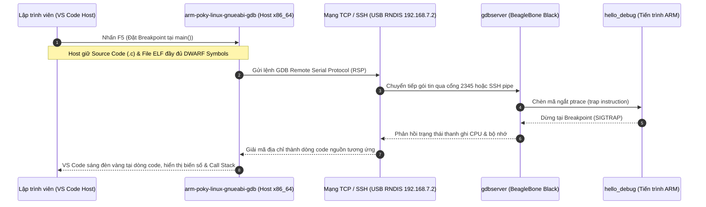
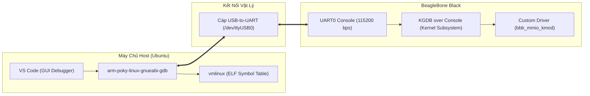

# Chương 31: Hướng Dẫn Build Image & Cấu Hình Remote Debug BeagleBone Black Bằng VS Code Trên Máy Chủ Host

---

## 1. Kiến Trúc Tổng Quan Về Remote Debugging Trong Hệ Thống Nhúng

Khi phát triển phần mềm nhúng chuyên nghiệp trên **BeagleBone Black (AM335x ARM Cortex-A8)** hoặc bất kỳ hệ thống Linux nhúng nào, việc debug bằng cách in log qua `printf()` thường tốn nhiều thời gian và khó bắt được các lỗi bộ nhớ phức tạp (segfault, memory leak, race condition). 

Phương pháp tiêu chuẩn công nghiệp là **Remote Debugging (Gỡ lỗi từ xa)** kết hợp với môi trường phát triển tích hợp đồ họa (**VS Code** trên máy tính Host).



### 1.1. Tại sao không chạy GDB trực tiếp trên BeagleBone Black?
1. **Tiết kiệm tài nguyên bo mạch**: BeagleBone Black chỉ có **512 MB RAM**. Trình gỡ lỗi GDB khi nạp một file nhị phân lớn cùng toàn bộ bảng ký hiệu DWARF (`.debug_info`) có thể ngốn từ vài trăm MB đến hơn 1 GB RAM, dẫn đến việc Linux Kernel kích hoạt **OOM Killer (Out-of-Memory Killer)** và tắt phụt tiến trình.
2. **Tách biệt dữ liệu**: Bo mạch (Target) chỉ cần chạy `gdbserver` dung lượng siêu nhẹ (~400 KB) và thực thi file nhị phân đã biên dịch. Toàn bộ mã nguồn gốc (`.c`, `.h`), các file thư viện đầy đủ symbol và giao diện đồ họa được lưu trữ, xử lý 100% trên máy tính máy chủ (Host PC).
3. **Trải nghiệm gỡ lỗi đồ họa**: Thay vì phải gõ từng câu lệnh CLI tẻ nhạt của GDB, lập trình viên có thể click chuột để đặt Breakpoint, hover chuột để xem giá trị biến, theo dõi đồ thị Call Stack và duyệt từng ô nhớ hex.

---

## 2. Quy Trình Cấu Hình & Build Image Yocto Hỗ Trợ Debug

Để BeagleBone Black có thể giao tiếp mượt mà với VS Code qua mạng, Image hệ điều hành cần tích hợp sẵn:
1. `gdbserver`: Trình phục vụ gỡ lỗi lắng nghe lệnh từ Host.
2. `dropbear` hoặc `openssh`: Máy chủ SSH cho phép nạp file (`scp`) và tạo đường ống kết nối (`pipeTransport`).
3. `debug-tweaks`: Bật chế độ đăng nhập `root` không cần mật khẩu.
4. Auto-mount `debugfs` (`/sys/kernel/debug`) và `tracefs` (`/sys/kernel/tracing`).

### 2.1. Recipe Image: `bbb-debug-image.bb`
Recipe này đã được tạo tại [`meta-myproject/recipes-core/images/bbb-debug-image.bb`](file:///home/thinh/yocto-bbb/meta-myproject/recipes-core/images/bbb-debug-image.bb):

```bitbake
SUMMARY = "BeagleBone Black Linux & Hardware Diagnostics with Remote Debugging"
DESCRIPTION = "Target rootfs with gdbserver, dropbear SSH, debugfs, and diagnostic utilities."
LICENSE = "MIT"

inherit core-image

# 1. Các tính năng cốt lõi cho gỡ lỗi
IMAGE_FEATURES += "\
    debug-tweaks \
    tools-debug \
    dbg-pkgs \
    ssh-server-dropbear \
"

# 2. Các gói phần mềm tiện ích chẩn đoán và điều khiển phần cứng
IMAGE_INSTALL += "\
    packagegroup-core-boot \
    bash \
    bash-completion \
    dropbear \
    nano \
    htop \
    strace \
    gdbserver \
    devmem2 \
    libgpiod-tools \
    i2c-tools \
    trace-cmd \
    bbb-diag \
    bbb-mmio-kmod \
"

# 3. Tinh chỉnh hệ thống: Bash làm shell mặc định và tự động mount debugfs
ROOTFS_POSTPROCESS_COMMAND += "customize_debug_rootfs; "

customize_debug_rootfs() {
    # Thiết lập Bash làm shell mặc định cho user root
    sed -i 's|root:x:0:0:root:/home/root:/bin/sh|root:x:0:0:root:/home/root:/bin/bash|' ${IMAGE_ROOTFS}/etc/passwd

    # Tự động mount debugfs và tracefs trong /etc/fstab
    if ! grep -q "debugfs" ${IMAGE_ROOTFS}/etc/fstab; then
        echo "debugfs /sys/kernel/debug debugfs defaults 0 0" >> ${IMAGE_ROOTFS}/etc/fstab
    fi
    if ! grep -q "tracefs" ${IMAGE_ROOTFS}/etc/fstab; then
        echo "tracefs /sys/kernel/tracing tracefs defaults 0 0" >> ${IMAGE_ROOTFS}/etc/fstab
    fi
}
```

### 2.2. Biên Dịch Image & Cross-Debugger Trên Host
Chạy các lệnh sau trong thư mục build của Yocto:
```bash
cd /home/thinh/yocto-bbb/
source poky/oe-init-build-env build

# Build target rootfs image
bitbake bbb-debug-image

# Build cross-GDB chạy trên máy tính x86_64 của bạn
bitbake gdb-cross-arm
```

Kết quả sinh ra:
- **Image thẻ nhớ**: `/home/thinh/yocto-bbb/build/tmp/deploy/images/beaglebone-yocto/bbb-debug-image-beaglebone-yocto.rootfs.wic`
- **Cross GDB**: `/home/thinh/yocto-bbb/build/tmp/sysroots-components/x86_64/gdb-cross-arm/usr/bin/arm-poky-linux-gnueabi/arm-poky-linux-gnueabi-gdb`

---

## 3. Khắc Phục Lỗi Thư Viện Của Yocto Cross-GDB Trên Máy Host

### Hiện tượng lỗi
Khi gọi trực tiếp file thực thi `arm-poky-linux-gnueabi-gdb` ngoài môi trường bitbake, hệ thống báo lỗi thiếu thư viện động:
```text
error while loading shared libraries: libtinfo.so.5: cannot open shared object file: No such file or directory
error while loading shared libraries: libpython3.12.so.1.0: cannot open shared object file: No such file or directory
```

### Nguyên nhân
Bộ công cụ Native của Yocto được biên dịch liên kết với các thư viện trong native sysroot (`sysroots-components/x86_64/`). Khi gọi trực tiếp từ terminal hoặc VS Code, biến môi trường `LD_LIBRARY_PATH` chưa được trỏ tới các thư mục này.

### Giải pháp: Tạo Script Wrapper `arm-gdb-wrapper.sh`
Tạo file wrapper tại thư mục dự án để làm cầu nối cho VS Code:
```bash
#!/bin/bash
# Wrapper script for Yocto's arm-poky-linux-gnueabi-gdb
YOCTO_SYSROOT_X86="/home/thinh/yocto-bbb/build/tmp/sysroots-components/x86_64"
export LD_LIBRARY_PATH="${YOCTO_SYSROOT_X86}/python3-native/usr/lib:${YOCTO_SYSROOT_X86}/ncurses-native/usr/lib:${LD_LIBRARY_PATH}"

GDB_BIN="${YOCTO_SYSROOT_X86}/gdb-cross-arm/usr/bin/arm-poky-linux-gnueabi/arm-poky-linux-gnueabi-gdb"

if [ -f "$GDB_BIN" ]; then
    exec "$GDB_BIN" "$@"
elif which gdb-multiarch >/dev/null 2>&1; then
    exec gdb-multiarch "$@"
else
    echo "Error: Không tìm thấy gdb-cross-arm hoặc gdb-multiarch!" >&2
    exit 1
fi
```
Cấp quyền thực thi:
```bash
chmod +x arm-gdb-wrapper.sh
```

> [!TIP]
> Bạn cũng có thể cài đặt `sudo apt install -y gdb-multiarch` trên Ubuntu host. `gdb-multiarch` hỗ trợ debug đa kiến trúc (ARM, AArch64, MIPS, RISC-V) và không đòi hỏi cấu hình `LD_LIBRARY_PATH`.

---

## 4. Cấu Hình VS Code Trên Máy Chủ Host

Một dự án C/C++ nhúng được cấu hình chuẩn trong thư mục `.vscode/` gồm 3 file:
1. `launch.json`: Cấu hình phiên gỡ lỗi (giao thức, địa chỉ IP, đường dẫn binary và symbol).
2. `tasks.json`: Tự động hóa quá trình biên dịch (`make`) và nạp file (`scp`) sang bo mạch.
3. `c_cpp_properties.json`: Cấu hình IntelliSense để VS Code hiểu toàn bộ hàm và định nghĩa phần cứng AM335x mà không bị gạch đỏ báo lỗi cú pháp.

### 4.1. Cấu hình `.vscode/launch.json`
Đường dẫn file: [`code_examples/07_vscode_remote_debugging/.vscode/launch.json`](file:///home/thinh/Obsidian/UBoot_BeagleBone/code_examples/07_vscode_remote_debugging/.vscode/launch.json)

```json
{
    "version": "0.2.0",
    "configurations": [
        {
            "name": "1. [1-Click Auto] Debug C/C++ on BeagleBone (SSH Pipe)",
            "type": "cppdbg",
            "request": "launch",
            "program": "${workspaceFolder}/hello_debug",
            "args": ["5"],
            "stopAtEntry": true,
            "cwd": "${workspaceFolder}",
            "environment": [],
            "externalConsole": false,
            "MIMode": "gdb",
            "miDebuggerPath": "${workspaceFolder}/scripts/arm-gdb-wrapper.sh",
            "preLaunchTask": "Build & Deploy to BeagleBone",
            "pipeTransport": {
                "pipeCwd": "${workspaceFolder}",
                "pipeProgram": "/usr/bin/ssh",
                "pipeArgs": [
                    "-o", "StrictHostKeyChecking=no",
                    "root@192.168.7.2"
                ],
                "debuggerPath": "gdbserver --once - /home/root/hello_debug"
            },
            "sourceFileMap": {
                "/home/root": "${workspaceFolder}",
                "/usr/src/debug": "${workspaceFolder}"
            },
            "setupCommands": [
                {
                    "description": "Bật hiển thị biến dạng Pretty Printing cho GDB",
                    "text": "-enable-pretty-printing",
                    "ignoreFailures": true
                },
                {
                    "description": "Tắt phân trang GDB",
                    "text": "set pagination off",
                    "ignoreFailures": true
                },
                {
                    "description": "Cấu hình đường dẫn Sysroot để nạp symbol thư viện liên kết động",
                    "text": "set solib-search-path /home/thinh/yocto-bbb/build/tmp/work/cortexa8hf-neon-poky-linux-gnueabi/my-app/1.0/recipe-sysroot/lib:/home/thinh/yocto-bbb/build/tmp/work/cortexa8hf-neon-poky-linux-gnueabi/my-app/1.0/recipe-sysroot/usr/lib",
                    "ignoreFailures": true
                }
            ]
        },
        {
            "name": "2. [Manual TCP] Debug C/C++ on BeagleBone (:2345)",
            "type": "cppdbg",
            "request": "launch",
            "program": "${workspaceFolder}/hello_debug",
            "args": [],
            "stopAtEntry": true,
            "cwd": "${workspaceFolder}",
            "environment": [],
            "externalConsole": false,
            "MIMode": "gdb",
            "miDebuggerPath": "${workspaceFolder}/scripts/arm-gdb-wrapper.sh",
            "miDebuggerServerAddress": "192.168.7.2:2345",
            "sourceFileMap": {
                "/home/root": "${workspaceFolder}",
                "/usr/src/debug": "${workspaceFolder}"
            },
            "setupCommands": [
                {
                    "text": "-enable-pretty-printing",
                    "ignoreFailures": true
                },
                {
                    "text": "set pagination off",
                    "ignoreFailures": true
                }
            ]
        }
    ]
}
```

#### Giải thích các tham số then chốt:
- `"pipeTransport"`: Thay vì phải vào terminal BeagleBone chạy `gdbserver :2345 ./hello_debug` thủ công mỗi lần sửa code, `pipeTransport` dùng chính giao thức SSH của máy tính để gọi ngầm lệnh `gdbserver --once - /home/root/hello_debug` thông qua stdin/stdout. Khi bạn bấm F5, mọi thứ diễn ra tự động hoàn toàn!
- `"sourceFileMap"`: Ánh xạ đường dẫn từ bo mạch (`/home/root`) về thư mục mã nguồn trên máy Host (`${workspaceFolder}`). Nhờ đó, khi con trỏ CPU của BeagleBone chạy đến địa chỉ nào, VS Code sẽ mở đúng dòng code tương ứng trong file `.c` trên màn hình của bạn.
- `"solib-search-path"`: Trỏ tới thư mục chứa các thư viện chia sẻ (`libc.so`, `libm.so`, `libgpiod.so`) trong sysroot của Yocto. Nhờ vậy GDB có thể đọc stack trace xuyên suốt các hàm hệ thống.

---

### 4.2. Cấu hình `.vscode/tasks.json`
Đường dẫn file: [`code_examples/07_vscode_remote_debugging/.vscode/tasks.json`](file:///home/thinh/Obsidian/UBoot_BeagleBone/code_examples/07_vscode_remote_debugging/.vscode/tasks.json)

```json
{
    "version": "2.0.0",
    "tasks": [
        {
            "label": "Build ARM Binary (Debug)",
            "type": "shell",
            "command": "make clean && make",
            "options": {
                "cwd": "${workspaceFolder}"
            },
            "group": {
                "kind": "build",
                "isDefault": true
            },
            "problemMatcher": ["$gcc"]
        },
        {
            "label": "Kill Remote GDBServer & Old App",
            "type": "shell",
            "command": "ssh -o StrictHostKeyChecking=no root@192.168.7.2 'killall -9 gdbserver hello_debug 2>/dev/null || true'",
            "problemMatcher": []
        },
        {
            "label": "Deploy to BeagleBone",
            "type": "shell",
            "command": "make deploy TARGET_IP=192.168.7.2",
            "options": {
                "cwd": "${workspaceFolder}"
            },
            "dependsOn": ["Kill Remote GDBServer"],
            "problemMatcher": []
        },
        {
            "label": "Build & Deploy to BeagleBone",
            "dependsOrder": "sequence",
            "dependsOn": [
                "Build ARM Binary (Debug)",
                "Deploy to BeagleBone"
            ],
            "problemMatcher": []
        }
    ]
}
```

Tác vụ `Build & Deploy to BeagleBone` được gán vào thuộc tính `"preLaunchTask"` trong `launch.json`. Chu trình tự động diễn ra khi bấm F5:
1. `make clean && make`: Dùng Toolchain của Yocto biên dịch file C thành file ELF ARM có gắn cờ `-g -O0`.
2. `Kill Remote GDBServer`: Đảm bảo không còn tiến trình cũ nào chiếm giữ cổng mạng hay file nhị phân.
3. `make deploy`: Tự động sao chép (`scp`) file nhị phân sang BeagleBone (`/home/root/hello_debug`) và phân quyền `chmod +x`.
4. Khởi chạy phiên debug!

---

### 4.3. Cấu hình `.vscode/c_cpp_properties.json`
Đường dẫn file: [`code_examples/07_vscode_remote_debugging/.vscode/c_cpp_properties.json`](file:///home/thinh/Obsidian/UBoot_BeagleBone/code_examples/07_vscode_remote_debugging/.vscode/c_cpp_properties.json)

```json
{
    "configurations": [
        {
            "name": "BeagleBone Black (ARM Cortex-A8)",
            "includePath": [
                "${workspaceFolder}/**",
                "/home/thinh/yocto-bbb/build/tmp/work/cortexa8hf-neon-poky-linux-gnueabi/my-app/1.0/recipe-sysroot/usr/include/**"
            ],
            "defines": [
                "_DEBUG",
                "UNICODE",
                "_UNICODE",
                "__ARM_ARCH_7A__"
            ],
            "compilerPath": "${workspaceFolder}/scripts/arm-gcc-wrapper.sh",
            "cStandard": "c11",
            "cppStandard": "c++17",
            "intelliSenseMode": "linux-gcc-arm"
        }
    ],
    "version": 4
}
```

---

## 5. Hướng Dẫn Debug Linux Kernel & Driver Bằng VS Code

Không chỉ giới hạn ở User-space, bạn hoàn toàn có thể dùng VS Code để gỡ lỗi trực quan chính **Linux Kernel** và các **Driver Kernel Module** (như driver `bbb-mmio-kmod` điều khiển thanh ghi AM335x) thông qua cơ chế **KGDB (Kernel GNU Debugger)** qua cổng UART Serial hoặc máy ảo QEMU.



### 5.1. Cấu hình Kernel Yocto cho KGDB
Trong file `.config` của Linux Kernel (thông qua `bitbake -c menuconfig virtual/kernel`), đảm bảo các tùy chọn sau được kích hoạt:
```ini
CONFIG_KGDB=y
CONFIG_KGDB_SERIAL_CONSOLE=y
CONFIG_DEBUG_KERNEL=y
CONFIG_DEBUG_INFO=y
CONFIG_DEBUG_INFO_DWARF_TOOLCHAIN_DEFAULT=y
CONFIG_FRAME_POINTER=y
CONFIG_MAGIC_SYSRQ=y
```

### 5.2. Kích hoạt KGDB trên BeagleBone Black
Khi boot Linux Kernel, thêm tham số vào bootargs trong U-Boot hoặc kích hoạt trực tiếp từ shell:
```bash
# Cách 1: Bootargs trong uEnv.txt
bootargs=console=ttyO0,115200n8 root=/dev/mmcblk0p2 rw kgdboc=ttyO0,115200 kgdbwait

# Cách 2: Kích hoạt khi Linux đã boot vào màn hình đăng nhập
echo ttyO0,115200 > /sys/module/kgdboc/parameters/kgdboc
echo g > /proc/sysrq-trigger
```
Khi lệnh trên thực thi, Kernel sẽ dừng toàn bộ CPU Core và in ra console:
```text
KGDB: Waiting for connection from remote gdb...
```

### 5.3. Cấu hình VS Code kết nối KGDB qua Serial
Thêm cấu hình sau vào `launch.json`:
```json
{
    "name": "3. [Linux Kernel] Debug Kernel vmlinux via KGDB Serial (/dev/ttyUSB0)",
    "type": "cppdbg",
    "request": "launch",
    "program": "/home/thinh/yocto-bbb/build/tmp/work/beaglebone_yocto-poky-linux-gnueabi/linux-yocto/6.6.21+git/linux-beaglebone_yocto-standard-build/vmlinux",
    "args": [],
    "stopAtEntry": false,
    "cwd": "${workspaceFolder}",
    "environment": [],
    "externalConsole": false,
    "MIMode": "gdb",
    "miDebuggerPath": "${workspaceFolder}/scripts/arm-gdb-wrapper.sh",
    "miDebuggerServerAddress": "/dev/ttyUSB0",
    "setupCommands": [
        {
            "description": "Thiết lập tốc độ baud rate cho cổng Serial KGDB",
            "text": "set serial baud 115200",
            "ignoreFailures": false
        },
        {
            "description": "Cấu hình Remote timeout",
            "text": "set remotetimeout 10",
            "ignoreFailures": true
        }
    ]
}
```

Bấm **F5** trong VS Code: GDB sẽ kết nối trực tiếp vào Kernel qua dây cáp Serial. Bạn có thể mở file mã nguồn driver C (ví dụ: hàm `bbb_mmio_open` hoặc `sys_open`), click chuột đặt chấm đỏ Breakpoint, sau đó từ BeagleBone kích hoạt lệnh gọi file — VS Code sẽ lập tức dừng CPU của BeagleBone và hiển thị dòng code Kernel đang chạy!

---

## 6. Hướng Dẫn Thực Hành Chi Tiết Từng Bước (Hands-on Walkthrough)

Dự án mẫu hoàn chỉnh đã được tạo sẵn tại:
[`code_examples/07_vscode_remote_debugging/`](file:///home/thinh/Obsidian/UBoot_BeagleBone/code_examples/07_vscode_remote_debugging/)

### Bước 1: Mở dự án trong VS Code
Trên máy tính Ubuntu Host, mở thư mục dự án:
```bash
code /home/thinh/Obsidian/UBoot_BeagleBone/code_examples/07_vscode_remote_debugging
```

### Bước 2: Kết nối BeagleBone Black
Cắm cáp USB mini kết nối BeagleBone Black với máy tính Host. Mạng RNDIS sẽ tự động nhận diện IP `192.168.7.2`.
Kiểm tra kết nối:
```bash
ping -c 3 192.168.7.2
ssh root@192.168.7.2 "uname -a"
```

### Bước 3: Đặt Breakpoint và chạy gỡ lỗi
1. Mở file [src/hello_debug.c](file:///home/thinh/Obsidian/UBoot_BeagleBone/code_examples/07_vscode_remote_debugging/src/hello_debug.c).
2. Click chuột vào mép lề trái tại dòng `91` (vòng lặp `for (int i = 1; i <= loop_limit; i++)`). Một **chấm tròn màu đỏ (Breakpoint)** sẽ xuất hiện.
3. Nhấn tổ hợp phím **`Ctrl + Shift + D`** để mở bảng điều khiển Debug.
4. Ở thanh menu trên cùng, chọn cấu hình: **`1. [1-Click Auto] Debug C/C++ on BeagleBone (SSH Pipe)`**.
5. Nhấn phím **`F5`**.

```text
[Quá trình tự động diễn ra trong 3 giây]:
  1. VS Code gọi Makefile biên dịch ARM binary có đầy đủ DWARF info.
  2. Dùng SCP copy sang /home/root/hello_debug trên BeagleBone Black.
  3. Kích hoạt SSH gdbserver kết nối ngầm.
  4. Mũi tên màu vàng dừng chính xác tại dòng 91 trong hàm main()!
```

### Bước 4: Khám phá các công cụ gỡ lỗi trên giao diện VS Code
Khi tiến trình dừng tại Breakpoint, bạn có thể thực hiện:
- **Thanh công cụ điều hướng**:
  - `F10 (Step Over)`: Đi qua từng dòng lệnh tiếp theo.
  - `F11 (Step Into)`: Đi sâu vào bên trong hàm con `calculate_adjusted_temperature()`.
  - `Shift + F11 (Step Out)`: Chạy hết hàm con và quay về hàm cha.
  - `F5 (Continue)`: Cho phép chương trình chạy tiếp tục cho đến khi gặp Breakpoint tiếp theo.
- **Bảng Variables (Biến số cục bộ & toàn cục)**:
  - Xem giá trị của biến đếm `i`, `loop_limit`.
  - Mở rộng struct `g_system_sensor` để xem chi tiết trường `temperature`, `voltage`, `status_flags`.
  - Bạn có thể **click đúp vào giá trị biến** để thay đổi trực tiếp ngay trong lúc chương trình đang chạy!
- **Bảng Watch (Theo dõi biểu thức nâng cao)**:
  - Bấm dấu `+` để thêm biểu thức: `g_system_sensor.temperature > 40.0` hoặc `samples[0]`.
- **Bảng Call Stack**:
  - Khi chương trình đang dừng trong hàm `process_sensor_buffer()`, Call Stack sẽ hiển thị chuỗi gọi: `process_sensor_buffer()` $\leftarrow$ `main()`. Nhấp vào từng frame để nhảy đến đúng vị trí tương ứng.

---

## 7. Bảng Tổng Hợp So Sánh Các Chế Độ Gỡ Lỗi

| Tiêu chí | Chế độ 1: SSH Pipe (1-Click Auto) | Chế độ 2: Manual TCP Socket (:2345) | Chế độ 3: KGDB Serial (/dev/ttyUSB0) |
| :--- | :--- | :--- | :--- |
| **Phạm vi gỡ lỗi** | User-space Application (C/C++) | User-space Application (C/C++) | Linux Kernel & Kernel Module (Drivers) |
| **Kênh giao tiếp** | Cáp mạng / USB RNDIS (SSH Port 22) | Cáp mạng / USB RNDIS (TCP Port 2345) | Dây cáp UART Serial (115200 bps) |
| **Thao tác lập trình viên** | Chỉ cần sửa code và nhấn **F5** | Phải gõ `gdbserver` trên target trước | Phải kích hoạt SysRq `echo g` trước |
| **Mức độ tự động hóa** | **Tự động 100%** (Build + Deploy + Launch) | Bán tự động | Thủ công |
| **Tốc độ truyền dữ liệu** | Rất nhanh (Ethernet/USB 2.0) | Rất nhanh (Ethernet/USB 2.0) | Trung bình (phụ thuộc baud rate 115200) |
| **Thích hợp cho** | Lập trình ứng dụng IoT, C/C++, GUI | Kiểm tra dịch vụ daemon chạy ngầm | Viết driver phần cứng, debug treo máy |

---

## 8. Kết Luận & Khuyến Nghị

1. **Luôn bật `debug-tweaks` và `tools-debug`** trong image thử nghiệm của Yocto để có sẵn `gdbserver` và đăng nhập root không mật khẩu qua SSH.
2. **Biên dịch mã với cờ `-g -O0`** khi đang phát triển để ngăn trình biên dịch tối ưu hóa làm biến mất biến số hoặc đảo lộn thứ tự dòng lệnh.
3. **Sử dụng chế độ 1-Click Auto SSH Pipe**: Đây là phương pháp chuyên nghiệp giúp tiết kiệm hàng trăm giờ thao tác thủ công, mang lại trải nghiệm lập trình nhúng trực quan và mượt mà tương tự như khi bạn phát triển ứng dụng thông thường trên máy tính!
