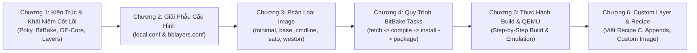

# 🐧 Giáo Trình Nghiên Cứu Chuyên Sâu: Yocto Project & Custom Embedded Linux Distribution (Mastery Edition)

Bộ tài liệu này được biên soạn và hệ thống hóa chuyên sâu dành riêng cho việc **học tập, nghiên cứu và làm chủ Yocto Project / Poky / BitBake** trong việc xây dựng các bản phân phối Linux nhúng chuyên nghiệp.

Tài liệu được thiết kế tương thích hoàn hảo với cơ chế liên kết ghi chú của **Obsidian**, tích hợp sơ đồ tư duy **Mermaid**, giải phẫu chi tiết các file cấu hình và các bài thực hành **Hands-on Lab từng bước**.

---

## 🗺️ LỘ TRÌNH HỌC TẬP & DANH SÁCH CÁC CHƯƠNG (CURRICULUM ROADMAP)

---

| Chương | Tên Chuyên Đề | Nội dung chính & Kỹ năng đạt được |
| :---: | :--- | :--- |
| **01** | [Chương 1: Kiến Trúc Tổng Quan & Khái Niệm Cốt Lõi](./docs/01_Kien_Truc_Tong_Quan_Va_Khai_Niem_Cot_Loi.md) | Bản chất của Yocto Project; 4 trụ cột: Poky, BitBake, OE-Core, Metadata; Phân loại Recipes (`.bb`), Appends (`.bbappend`), Classes (`.bbclass`), Configuration (`.conf`); Kiến trúc Layer phân tầng (`meta-*`) và nguyên lý tách biệt BSP/Distro/App. |
| **02** | [Chương 2: Giải Phẫu local.conf & bblayers.conf](./docs/02_Giai_Phau_File_Cau_Hinh_local_conf_Va_bblayers_conf.md) | Giải thích từng chỉ thị trong `local.conf`: `MACHINE`, `DISTRO`, `PACKAGE_CLASSES` (ipk/deb/rpm), `EXTRA_IMAGE_FEATURES` (`debug-tweaks`, `tools-debug`, `ssh-server`), `DL_DIR` & `SSTATE_DIR` (tối ưu tốc độ build 80%), quy tắc override hiện đại với dấu `:` thay cho `_`. Quản lý Layer qua `bblayers.conf` và công cụ `bitbake-layers`. |
| **03** | [Chương 3: Các Loại Image Tiêu Chuẩn & Ý Nghĩa](./docs/03_Cac_Loai_Image_Tieu_Chuan_Va_Y_Nghia.md) | Phân tích 5 loại Image chuẩn: `core-image-minimal` (mang tính bring-up), `core-image-base` (nền tảng IoT), `core-image-full-cmdline` (server nhúng), `core-image-sato` (X11 touch UI), `core-image-weston` (Wayland đồ họa hiện đại); Bảng so sánh dung lượng RootFS, RAM và thời gian build. |
| **04** | [Chương 4: Quy Trình BitBake Task Execution Flow](./docs/04_Quy_Trinh_BitBake_Task_Execution_Flow.md) | Vòng đời tác vụ của một Recipe: `do_fetch` $\rightarrow$ `do_unpack` $\rightarrow$ `do_patch` $\rightarrow$ `do_configure` $\rightarrow$ `do_compile` $\rightarrow$ `do_install` (thư mục giả lập `${D}`) $\rightarrow$ `do_package` $\rightarrow$ `do_rootfs`; Cơ chế mã băm Signature Generator và Shared State Cache (`sstate-cache`); Từ điển lệnh BitBake (`-c listtasks`, `-c menuconfig`, `-c cleansstate`, `-e`). |
| **05** | [Chương 5: Thực Hành Build Image & Chạy Mô Phỏng QEMU](./docs/05_Thuc_Hanh_Step_By_Step_Build_Image_Va_Emulation.md) | Cài đặt gói phụ thuộc trên Ubuntu 22.04/24.04; Clone Poky LTS **Scarthgap 5.0**; Khởi tạo `oe-init-build-env`; Cấu hình và build `core-image-minimal`; Chạy mô phỏng máy ảo bằng `runqemu qemuarm nographic`; Hướng dẫn build cho bo mạch thật BeagleBone Black (`MACHINE = "beaglebone-yocto"`), nạp file `.wic` vào thẻ nhớ MicroSD bằng `bmaptool` hoặc `dd`. |
| **06** | [Chương 6: Tạo Custom Layer, Viết Recipe C & Tùy Biến Custom Image](./docs/06_Tao_Custom_Layer_Viet_Recipe_Va_Custom_Image.md) | Sử dụng `bitbake-layers create-layer` và `add-layer`; Viết mã nguồn C (`main.c`, `Makefile`) và đóng gói thành `my-app_1.0.bb`; Hướng dẫn thực chiến tùy biến `my-custom-image` và `my-iot-image`: vị trí file, thêm gói `IMAGE_INSTALL`, bật tính năng `IMAGE_FEATURES`, tăng dung lượng đĩa `IMAGE_ROOTFS_EXTRA_SPACE`, tạo user/mật khẩu, và chạy script post-process. |

---

## 🔗 LIÊN KẾT HỆ SINH THÁI GHI CHÚ TRONG VAULT (CROSS-REFERENCES)

Bộ tài liệu này kết hợp chặt chẽ với các bộ tài liệu Embedded Linux khác có sẵn trong Obsidian của bạn:

- 🦴 **Bootloader nạp Linux Kernel**: Xem chi tiết kiến trúc khởi động, phân vùng thẻ nhớ và cấu hình U-Boot tại [UBoot_BeagleBone/README.md](../UBoot_BeagleBone/README.md).
- 🐧 **Linux Kernel & Trình điều khiển thiết bị (Drivers)**: Xem chi tiết cấu hình nhân, Device Tree và lập trình Driver tại [Linux_Bootlin/docs/README.md](../Linux_Bootlin/docs/README.md).

---

## 📚 TÀI NGUYÊN & CỔNG THÔNG TIN TRA CỨU CHÍNH THỨC

1. **Yocto Project Official Documentation**: [https://docs.yoctoproject.org/](https://docs.yoctoproject.org/)
2. **OpenEmbedded Layer Index** (Nơi tìm kiếm các layer bên thứ ba): [https://layers.openembedded.org/](https://layers.openembedded.org/)
3. **Poky Source Repository**: [https://git.yoctoproject.org/poky](https://git.yoctoproject.org/poky)
4. **Bootlin Yocto Project Training Materials**: [https://bootlin.com/training/yocto/](https://bootlin.com/training/yocto/)
