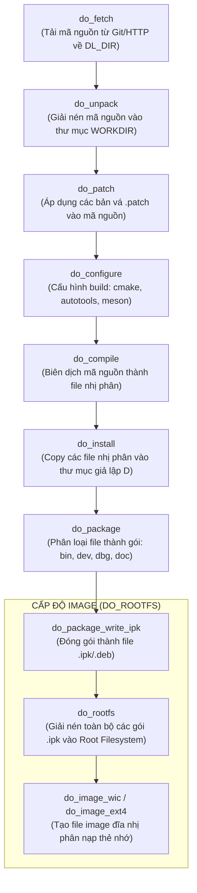

# ⚙️ Chương 4: Quy Trình Thực Thi Tác Vụ Của BitBake (Task Execution Flow)

> **Tài liệu tham khảo chính thức**:
> - [BitBake User Manual: Execution Tasks](https://docs.yoctoproject.org/bitbake/bitbake-user-manual/bitbake-user-manual-execution.html)
> - [Yocto Project Overview: Shared State Cache](https://docs.yoctoproject.org/overview-manual/concepts.html#shared-state-cache)

---

## 1. VÒNG ĐỜI CỦA MỘT RECIPE (RECIPE TASK PIPELINE)

Khi bạn yêu cầu BitBake build một gói phần mềm (hoặc một image), BitBake không chỉ chạy một lệnh duy nhất. Thay vào đó, nó chia nhỏ quy trình thành một chuỗi các **Tác vụ (Tasks)** tuần tự có kiểm soát chặt chẽ:

---

### Phân tích chi tiết từng Task:

#### 1. `do_fetch`
- **Mục tiêu**: Tải toàn bộ mã nguồn được khai báo trong biến `SRC_URI` (Git repository, tarball HTTP, SVN, hoặc file cục bộ) về thư mục `${DL_DIR}`.
- **Kiểm tra tính toàn vẹn**: So sánh mã băm `md5sum` và `sha256sum` của file tải về với giá trị khai báo trong recipe để chống tải mã độc hoặc file hỏng.

#### 2. `do_unpack`
- **Mục tiêu**: Giải nén mã nguồn từ `${DL_DIR}` vào thư mục làm việc cục bộ của gói (`${WORKDIR}`).
- Biến `${S}` (Source directory) thường trỏ tới thư mục mã nguồn vừa giải nén (ví dụ `${WORKDIR}/git` hoặc `${WORKDIR}/${BP}`).

#### 3. `do_patch`
- **Mục tiêu**: Tự động áp dụng tất cả các file bản vá sửa lỗi (`.patch`) được liệt kê trong `SRC_URI` bằng lệnh `patch -p1`.
- Cho phép lập trình viên chỉnh sửa tính năng, fix bug upstream mà không cần phải can thiệp vào kho Git gốc.

#### 4. `do_configure`
- **Mục tiêu**: Chuẩn bị môi trường biên dịch (tương tự `./configure` trên Linux thông thường).
- Nếu recipe kế thừa `inherit cmake`: Task này tự động chạy `cmake` kèm theo toàn bộ tham số toolchain ARM, đường dẫn sysroot của thư viện chéo.
- Nếu recipe kế thừa `inherit autotools`: Chạy `autoreconf` và `./configure --host=arm-linux-...`.

#### 5. `do_compile`
- **Mục tiêu**: Thực thi lệnh biên dịch mã nguồn (gọi `make -j` hoặc `ninja`) bằng trình biên dịch chéo Cross-compiler (ví dụ `arm-poky-linux-gnueabi-gcc`).

#### 6. `do_install`
- **Mục tiêu**: Copy các file nhị phân (`bin/`), thư viện (`lib/`), header (`include/`), và file dịch vụ systemd vào **thư mục đích giả lập (Destination Directory: `${D}`)**.
- > [!IMPORTANT]
  > Biến `${D}` tương đương với một cây thư mục gốc `/` thu nhỏ của riêng gói phần mềm đó. Ví dụ lệnh:
  > `install -m 0755 myapp ${D}${bindir}`
  > sẽ copy file `myapp` vào `${D}/usr/bin/myapp`. Khi nạp lên board nhúng, file sẽ nằm chính xác tại `/usr/bin/myapp`.

#### 7. `do_package` & `do_package_write_*`
- **Mục tiêu**: BitBake tự động quét thư mục `${D}` và phân tách thành nhiều gói con độc lập:
  - `${PN}`: Chứa file thực thi chính cho người dùng.
  - `${PN}-dev`: Chứa file header `.h` và thư viện tĩnh `.a`.
  - `${PN}-dbg`: Chứa symbol gỡ lỗi (debug symbols).
  - `${PN}-doc`: Chứa tài liệu man pages.
- Sau đó, task `do_package_write_ipk` (hoặc `deb`/`rpm`) sẽ nén các gói này lại thành file cài đặt sẵn sàng.

---

## 2. BÍ MẬT TĂNG TỐC BUILD: SHARED STATE CACHE (SSTATE-CACHE)

Một trong những phát minh vĩ đại nhất của Yocto Project là cơ chế **Shared State Cache (`sstate-cache`)**:

### Cơ chế hoạt động:
1. Mỗi khi chuẩn bị chạy một task (ví dụ `do_compile`), BitBake tính toán một **mã băm chữ ký (Task Hash / Signature)** đại diện cho toàn bộ yếu tố đầu vào:
   - Nội dung mã nguồn của recipe.
   - Phiên bản compiler và cờ tối ưu (`CFLAGS`).
   - Hash của tất cả các gói phụ thuộc (Dependencies).
2. BitBake kiểm tra trong thư mục `sstate-cache`:
   - **Cache HIT**: Nếu tìm thấy một file `.tar.zst` có mã băm trùng khớp 100% $\rightarrow$ **BitBake BỎ QUA việc biên dịch**, chỉ cần giải nén kết quả build đã có sẵn!
   - **Cache MISS**: Nếu phát hiện mã băm thay đổi (do bạn sửa code hoặc đổi compiler flag) $\rightarrow$ BitBake thực thi task từ đầu và lưu kết quả mới vào cache.

---

## 3. TỪ ĐIỂN CÁC LỆNH BITBAKE THIẾT YẾU CHO LẬP TRÌNH VIÊN

Khi phát triển và gỡ lỗi trên Yocto, bạn không cần phải gõ `bitbake <image>` để build toàn bộ hệ điều hành. Hãy sử dụng các lệnh tương tác mục tiêu sau:

| Lệnh BitBake | Mục đích & Ý nghĩa kỹ thuật |
| :--- | :--- |
| `bitbake <recipe>` | Chỉ biên dịch một gói phần mềm duy nhất (Ví dụ: `bitbake nginx`, `bitbake virtual/kernel`). |
| `bitbake <recipe> -c listtasks` | Liệt kê tất cả các task có thể thực thi của recipe đó. |
| `bitbake <recipe> -c compile` | Buộc BitBake dừng lại ngay sau khi hoàn thành task `do_compile` (tiện cho việc xem lỗi code C). |
| `bitbake virtual/kernel -c menuconfig` | Mở giao diện đồ họa ncurses của Linux Kernel để tùy biến cấu hình nhân (bật/tắt driver). |
| `bitbake <recipe> -c cleansstate` | **Xóa sạch cache của gói này**: Ép BitBake phải tải lại và build lại từ đầu (dùng khi bạn sửa code nhưng BitBake không nhận). |
| `bitbake <recipe> -c cleanall` | Xóa sạch cả cache SState và file mã nguồn đã tải trong `DL_DIR`. |
| `bitbake -e <recipe> \| grep ^S=` | In toàn bộ các biến môi trường sau khi BitBake đã giải mã (Ví dụ: tìm xem thư mục `${S}` đang nằm ở đâu trên ổ cứng). |
| `bitbake -g <image> && cat pn-build-list` | Sinh sơ đồ cây phụ thuộc giữa tất cả các gói trong image. |

---

## 4. TỔNG KẾT BÀI HỌC

1. Hiểu rõ từng mắt xích trong chuỗi Task (`fetch` $\rightarrow$ `unpack` $\rightarrow$ `patch` $\rightarrow$ `configure` $\rightarrow$ `compile` $\rightarrow$ `install` $\rightarrow$ `package`) giúp bạn biết chính xác cần tìm file log ở đâu khi build bị lỗi.
2. Tận dụng `sstate-cache` là chìa khóa để tiết kiệm hàng chục tiếng đồng hồ build máy tính.
3. Kỹ năng can thiệp trực tiếp vào từng task (`-c compile`, `-c menuconfig`, `-c cleansstate`) là phẩm chất bắt buộc của một Embedded Linux Engineer chuyên nghiệp.
